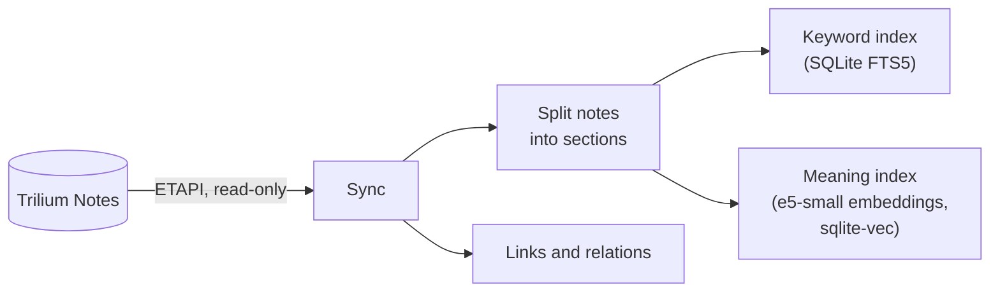
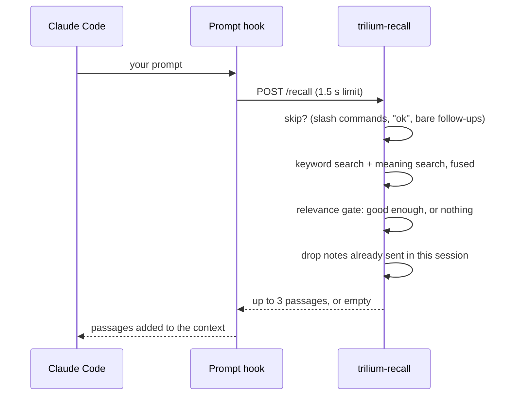

# How it works

## Indexing

The engine keeps its own copy of what it needs to search, in a SQLite file on its volume. Trilium stays untouched.

- **First start:** a full build, about half a minute for a few hundred notes. `/health` says `starting` until it's done.
- **Every minute:** notes changed since the last run are picked up.
- **Every 30 minutes:** a full comparison catches deletions, moves and label changes. Trilium doesn't mark a note as modified when only its attributes change, so those wait for this run.

Indexed: all text and code notes. Left out: archived notes, Trilium's hidden notes and, with an LLM wiki, its plumbing (*Locks*, *Templates*, *Views*). Notes are sorted into areas: wiki, sources, journal (found by `#calendarRoot`) and everything else.

## Answering a prompt

- **Two searches, one list.** Keyword matches and meaning matches are merged (reciprocal rank fusion), then weighted by area: wiki pages first, then sources, then journal and other notes.
- **Silence is a feature.** A gate drops results whose meaning similarity is below a fixed threshold, so an unrelated prompt gets nothing rather than three weak guesses. Strong keyword matches on several terms get through anyway.
- **Summaries stand in for sources.** With an LLM wiki, a source that has a summary page shows up as the summary, unless the source itself holds the matching detail.
- **No repeats.** Within one Claude Code session, a note is sent once.
- **Never in the way.** No config, a slow or broken engine, any error: the hook adds nothing and the prompt goes through.

The `recall` MCP tool runs the same search, without the skip and session steps.

## Security

One secret, `RECALL_LOGIN_PASSWORD`, guards both `/recall` and `/mcp`: as a Bearer header, or as the password on the engine's OAuth login page (with `RECALL_BASE_URL` set). The login comes from the shared [mcp-login-oauth](https://github.com/Marceltov/mcp-login-oauth) library. Whoever holds the password can search every configured instance.

The engine's ETAPI token could write (Trilium has no read-only tokens), but the engine only sends GET requests. Keep that token in the engine's environment and nowhere else.
