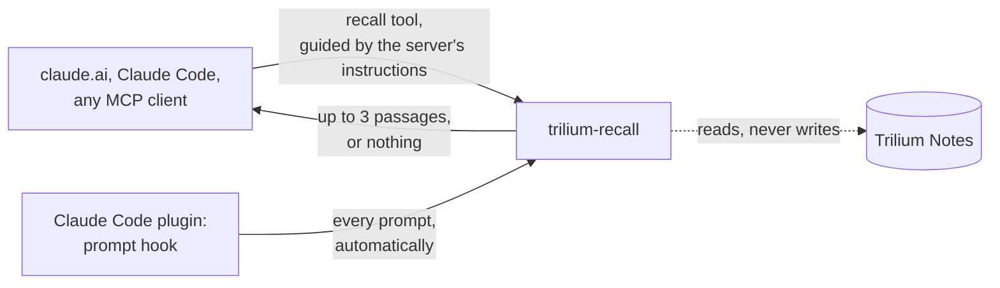

---
hide:
  - toc
---

!!! warning "trilium-recall is superseded by passageway"
    trilium-recall is no longer developed. Its engine lives on as [passageway](https://passageway.marceltov.de/): the same retrieval with Trilium as one connector among others, a choice of models and a public measurement. Use passageway for anything new; [Moving to passageway](migrate.md) says what changes. The pages here describe trilium-recall as it was left.

# Claude remembers what you wrote in Trilium

trilium-recall is a small container next to Trilium Notes. Before Claude answers, it looks up whether your notes already hold something relevant and hands Claude the few lines that matter. You don't have to say "check my notes".

[Move to passageway](migrate.md){ .md-button .md-button--primary } [Run the engine](install.md){ .md-button }

## In numbers

  

    &gt; 85 %
    of questions get the right note among the first three
    Trilium's own search: around 40 %
  

  

    &gt; 90 %
    of questions the notes can't answer get nothing back
    instead of three weak guesses
  

  

    &lt; 20 ms
    per lookup, typical (p50)
    well inside the hook's 1.5 s limit
  

Measured on a real 280-note Trilium with 49 test questions; yours will differ. [All measurements and charts](measurements.md)

## What you get

- **An MCP server for any client.** Add one URL to claude.ai, Claude Code or any other MCP client. The server's instructions tell the model when to call `recall`; it gets up to three short passages (title, the best lines, note ID and links), a few hundred tokens, or nothing.
- **Automatic in Claude Code.** The optional plugin adds a prompt hook that checks every prompt before Claude sees it, so recall doesn't depend on the model deciding to look.
- **Fast and quiet.** A slow or unreachable engine never holds up a prompt.
- **German and English.** A multilingual embedding model next to keyword search finds notes by meaning, not only by exact words.
- **Safe to run.** It reads Trilium through ETAPI and never writes. Its index can be deleted and rebuilt at any time.

## Works with any Trilium

Recall indexes all text and code notes. If you keep an [LLM wiki](https://trilium-llm-wiki.marceltov.de/) in Trilium, it also knows the wiki's structure: wiki pages rank first, sources show up as their summaries, and the wiki's plumbing stays out of the index.

## Get started

1. [Run the engine](install.md) next to Trilium (one compose service).
2. [Connect Claude](connect.md): add the URL to any MCP client, and the plugin for automatic mode in Claude Code.
