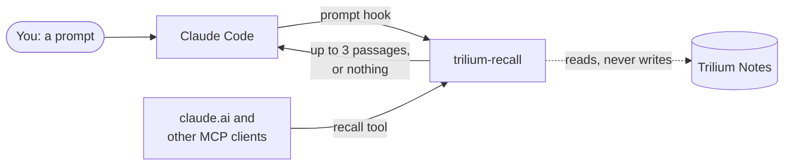

---
hide:
  - toc
---

# Claude knows what your Trilium notes know

trilium-recall is a small container next to Trilium Notes. Before Claude answers, it looks up whether your notes already hold something relevant and hands Claude the few lines that matter. You don't have to say "check my notes".

[Run the engine](install.md){ .md-button .md-button--primary } [Connect Claude](connect.md){ .md-button }

## What you get

- **In Claude Code, automatic.** A prompt hook sends each prompt to the engine. When your notes have something relevant, Claude gets up to three short passages (title, the best lines, note ID and links), a few hundred tokens. When they have nothing, Claude gets nothing.
- **In any MCP client, on request.** A `recall` tool that claude.ai, the Claude apps or any other client can call mid-task.
- **Fast and quiet.** About 16 ms per lookup on a real 280-note Trilium, and a slow or unreachable engine never holds up a prompt. See [Measurements](measurements.md).
- **German and English.** A multilingual embedding model next to keyword search finds notes by meaning, not only by exact words.
- **Safe to run.** It reads Trilium through ETAPI and never writes. Its index can be deleted and rebuilt at any time.

## Works with any Trilium

Recall indexes all text and code notes. If you keep an [LLM wiki](https://trilium-llm-wiki.marceltov.de/) in Trilium, it also knows the wiki's structure: wiki pages rank first, sources show up as their summaries, and the wiki's plumbing stays out of the index.

## Get started

1. [Run the engine](install.md) next to Trilium (one compose service).
2. [Connect Claude](connect.md): the Claude Code plugin for the hook, a connector for claude.ai.
