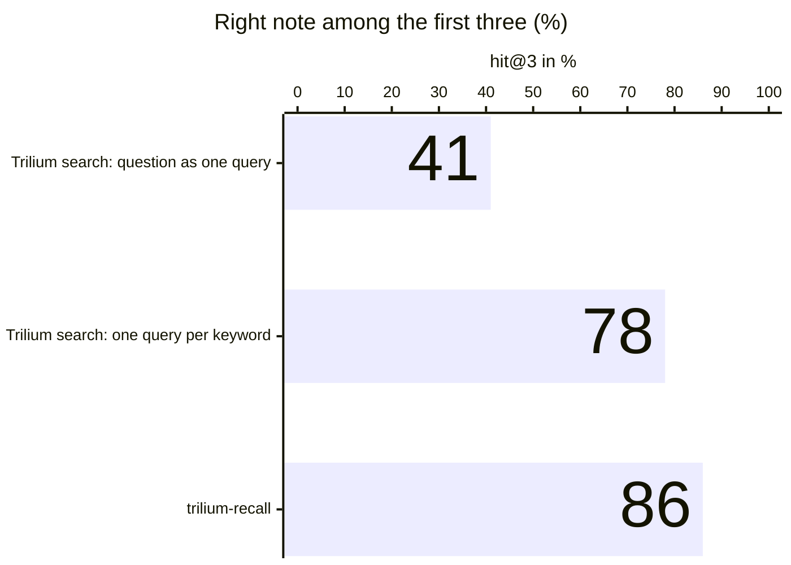
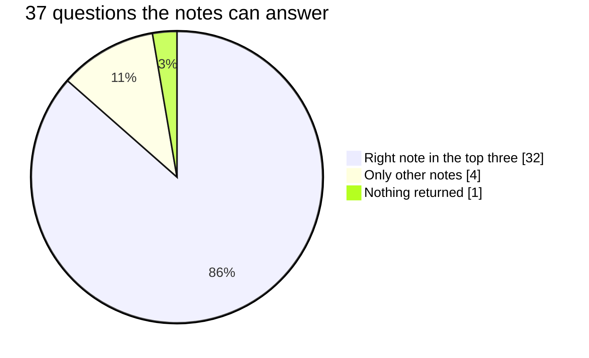
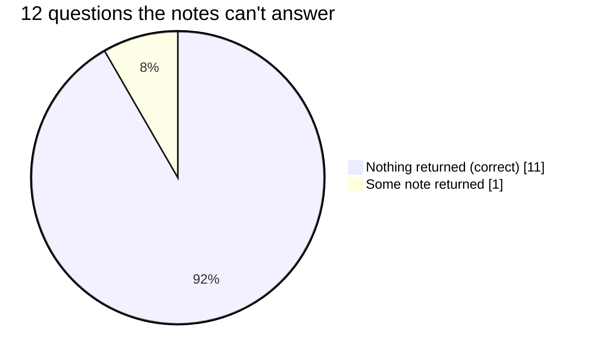
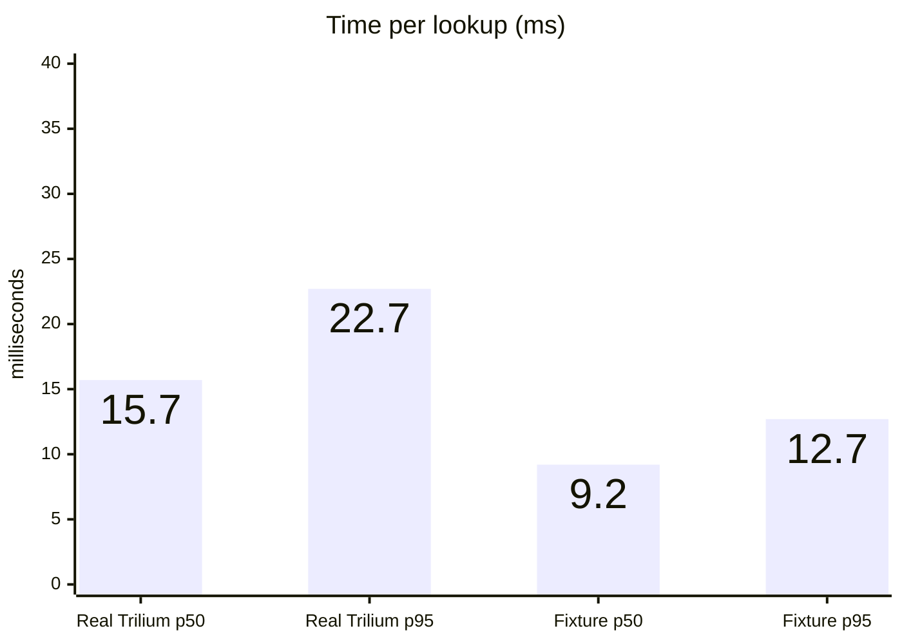

# Measurements

<div class="tm-kpis">
  <div class="tm-kpi">
    <span class="tm-kpi__value">86 %</span>
    <span class="tm-kpi__label">of questions get the right note among the first three</span>
    <span class="tm-kpi__note">Trilium's own search: 41 %</span>
  </div>
  <div class="tm-kpi">
    <span class="tm-kpi__value">92 %</span>
    <span class="tm-kpi__label">of questions the notes can't answer get nothing back</span>
    <span class="tm-kpi__note">instead of three weak guesses</span>
  </div>
  <div class="tm-kpi">
    <span class="tm-kpi__value">16 ms</span>
    <span class="tm-kpi__label">per lookup, typical (p50)</span>
    <span class="tm-kpi__note">about 1 % of the hook's 1.5 s limit</span>
  </div>
</div>

Measured with the engine's own evaluation command (`eval.py`) on 0.5.0, 2026-10-26, on the author's
Trilium: 279 notes in 860 sections, mostly an LLM wiki about a homelab, tools and paperwork, in
German and English. 49 cases, each a question plus the note that should answer it: 37 answerable,
12 that the notes can't answer. The questions stay private, because they describe the notes. The
engine runs in a homelab container with a 600 MB memory limit and no GPU.

## Finding the right note

The same 49 questions, answered by recall and by Trilium's full-text search through its MCP server:



Trilium's search needs every word of the question in the note, so it often comes back empty: for
38 % of the answerable questions. Searching keyword by keyword gets close (78 %), but takes 5.3
searches and 391 ms per question and always returns something. Recall finds paraphrases and
questions asked in the other language in one call of about 16 ms.

## What happened to each question





The right note also tends to come first: mean reciprocal rank 0.82, where 1 would mean always first.

## Speed

Median of three runs per measure; recall answers well inside the hook's 1.5 s limit:



??? info "All numbers as tables"

    **Real Trilium, 49 cases**

    | Measure | Value |
    |---|---|
    | hit@3: the right note among the first three | 0.86 (32 of 37) |
    | MRR: how high the right note ranks (1 = always first) | 0.82 |
    | silence: nothing returned for an unanswerable question | 0.92 (11 of 12) |
    | false silence: nothing returned although a note answers it | 0.03 (1 of 37) |
    | latency p50 / p95, three runs | 15.4–16.1 ms / 19.4–32.8 ms |

    **Compared with Trilium's own search**

    | | hit@3 | empty although a note answers | silent when nothing fits | calls per question | p50 |
    |---|---|---|---|---|---|
    | trilium-recall | 0.86 | 0.03 | 0.92 | 1 | 16 ms |
    | Trilium search, the question as one query | 0.41 | 0.38 | 0.83 | 1 | 155 ms |
    | Trilium search, one query per keyword | 0.78 | 0.00 | 0.00 | 5.3 | 391 ms |

    **Public fixture, 17 cases**

    | Measure | Value |
    |---|---|
    | hit@3 | 0.83 (10 of 12) |
    | MRR | 0.83 |
    | silence | 1.0 (5 of 5) |
    | false silence | 0.17 (2 of 12) |
    | latency p50 / p95, three runs | 8.5–9.4 ms / 11.5–17.7 ms |

## On the public fixture

`engine/fixture/` holds a disposable Trilium (Trilium's demo notes plus a small synthetic wiki) and
`engine/eval/fixture-cases.yaml` 17 cases for it: 12 answerable, 5 unanswerable. CI runs them on
every change. Its numbers are in the tables above; to reproduce them:

```bash
cd engine
docker compose up -d --build --wait      # fixture Trilium on :9190, engine on :9191
uv run python app/eval.py --url http://localhost:9191 --token dev-only-recall-password \
  --cases eval/fixture-cases.yaml --verbose
docker compose stop
```

`./run-tests.sh` does the same with the full test suite and resets the fixture's database afterwards.

## Measure your own

Write a YAML file of questions with the pages that should
answer them, plus some your notes cannot answer:

```yaml
- {query: "how are the guests backed up?", expect: [<noteId>]}
- {query: "Wie melde ich ein Gewerbe an?", expect: [<noteId>]}
- {query: "best sourdough hydration", expect: none}
```

and run it against the engine:

```bash
docker compose exec trilium-recall python eval.py --url http://localhost:8082 \
  --token "$RECALL_LOGIN_PASSWORD" --cases /data/cases.yaml --verbose
```

It reports hit@3 (the right page among the first three), silence on unanswerable questions and
latency. Keep your questions private: they describe your notes.
